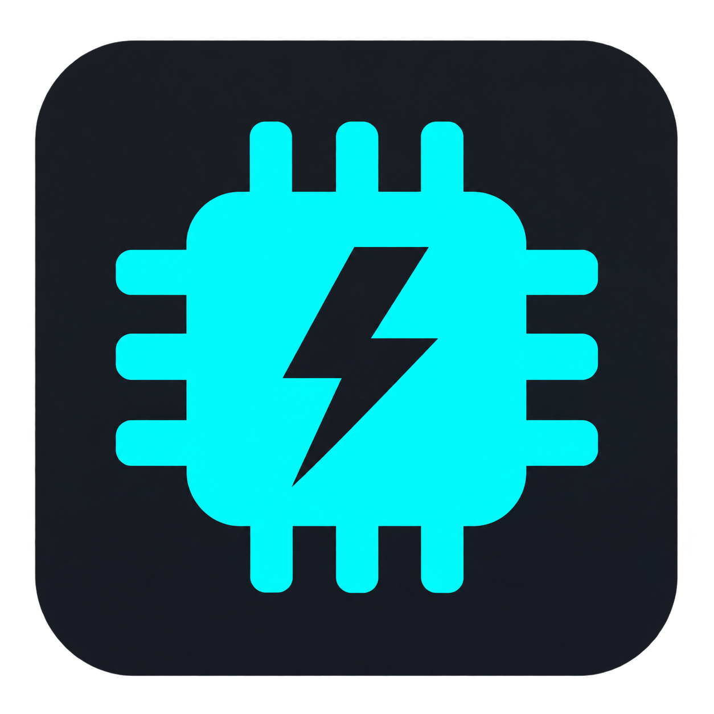
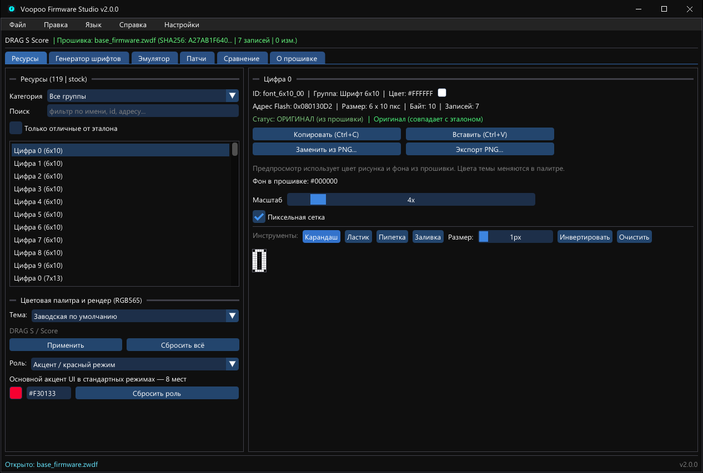

<p align="center">
  
</p>

<h1 align="center">Voopoo Firmware Studio</h1>

<p align="center">
  Редактор прошивок VOOPOO DRAG (<code>.zwdf</code> / <code>.swdf</code> / <code>.xwdf</code>) для Windows 10/11 x64.
</p>

<p align="center">
  <a href="CHANGELOG.md"></a>
  <a href="https://github.com/D4n13l3k00/VoopooFirmwareStudio/actions/workflows/ci-release.yml"></a>
  
  
  <a href="https://github.com/ocornut/imgui"></a>
  <a href="https://github.com/D4n13l3k00/VoopooFirmwareStudio/releases"></a>
</p>

<p align="center">
  <a href="https://github.com/D4n13l3k00/VoopooFirmwareStudio/releases/latest">Скачать для Windows x64</a>
</p>

<p align="center">
  
</p>

## Возможности

- «Ресурсы» и «Цветовая палитра»: пиксельный редактор, импорт и экспорт PNG, цветовые темы и монохромная графика.
- «Генератор шрифтов»: шрифты из TTF/OTF и установленных шрифтов.
- Проекты `.vfwp` с прошивкой, исходными изображениями и правками.
- «Эмулятор → Экраны»: предпросмотр для 21 профиля и 75 аппаратных ревизий.
- «Сравнение»: графические ресурсы двух прошивок.
- «Расположение UI»: перемещение, выравнивание, сетка и направляющие.
- «Кастомные экраны»: запуск, выключение и CHIP ID для DRAG S Score / Factory с изображениями и анимациями.
- «Меню устройства»: дополнительные данные, выбор отображаемого напряжения, редакторы тяг и очков достижений, выбор ранга.
- «Эмулятор → Устройство»: DRAG S Score / Factory с кнопками, датчиком затяжки, паузой и пошаговым выполнением.

## Поддержка устройств
<details>
<summary>Совместимость моделей и доступные редакторы</summary>


Для всех профилей доступны «Ресурсы», «Генератор шрифтов», «Эмулятор → Экраны», «Сравнение» и «Расположение UI».

| Модель | Версии прошивки | Ресурсы | Цветовая палитра | Генератор шрифтов | Эмулятор → Экраны | Эмулятор → Устройство | Кастомные экраны | Расположение UI | Меню устройства | Сравнение |
| --- | --- | :---: | :---: | :---: | :---: | :---: | :---: | :---: | :---: | :---: |
| DRAG S | Score, Factory | Да | Да | Да | Да | Да | Да* | Да* | Да* | Да |
| DRAG X | Score, Factory | Да | Да | Да | Да | — | — | Да* | — | Да |
| DRAG S PRO | Factory, TC | Да | Да | Да | Да | — | — | Да* | — | Да |
| DRAG X PRO | TC | Да | Да | Да | Да | — | — | Да* | — | Да |
| DRAG X PLUS | Factory, TC | Да | Да | Да | Да | — | — | Да* | — | Да |
| DRAG X PLUS PRO | TC | Да | Да | Да | Да | — | — | Да* | — | Да |
| DRAG 3 | Factory, TC | Да | Да | Да | Да | — | — | Да* | — | Да |
| DRAG MAX | Standard | Да | Да | Да | Да | — | — | Да* | — | Да |
| DRAG | Standard | Да | — | Да | Да | — | — | Да* | — | Да |
| DRAG 2 | Standard | Да | — | Да | Да | — | — | Да* | — | Да |
| DRAG mini | V1, V2 | Да | — | Да | Да | — | — | Да* | — | Да |
| DRAG 2 Refresh Edition | Standard, FIT3 | Да | — | Да | Да | — | — | Да* | — | Да |
| DRAG mini Refresh Edition | Standard, FIT3 | Да | — | Да | Да | — | — | Да* | — | Да |

\* Проверено только в ВМ и/или предпросмотре UI; на физическом устройстве эти патчи не проверялись.

DRAG, DRAG 2, mini и Refresh Edition используют монохромную графику без редактирования палитры. «Редактор очков достижений» и «Выбор ранга достижения» доступны только для DRAG S Score.

Поддержка относится к перечисленным профилям прошивок, а не к любой прошивке той же модели.
</details>


## Кабель для прошивки DRAG X / DRAG S

Распайка по предоставленной схеме: USB со стороны ПК → контакты USB-C со стороны устройства.

```text
+5V -----------> VBUS
D- ------------> B8
D+ ------------> A8
GND -----------> GND
```


Схема аппаратно проверена на двух ревизиях DRAG S; проверка на DRAG X не подтверждена. Для записи прошивки нужна отдельная [программа VOOPOO](https://sen.voopoo.com.cn/www-voopoo/static/dist/uploads/20210415/voopoo.exe); студия только редактирует файлы.

## Сборка

C++20, Dear ImGui, DirectX 11, статический CRT (`/MT`). Нужны Visual Studio 2022/2026 с C++ x64, Windows SDK и CMake.

В Developer Command Prompt:

```cmd
msbuild VoopooFirmwareStudio.sln /p:Configuration=Release /p:Platform=x64
```


## Лицензии

Собственные исходники — [MIT](LICENSE); Unicorn — [GPLv2](third_party/UNICORN-COPYING). Распространение объединённого EXE требует соблюдения GPLv2; релиз включает соответствующие исходники студии и Unicorn.

Markdown: [MD4C 0.6.0](third_party/markdown/md4c.LICENSE) и [imgui_md](third_party/markdown/imgui_md.LICENSE), MIT.
Сжатие проектов: liblzma из XZ 5.8.1, [0BSD](third_party/xz.LICENSE).
